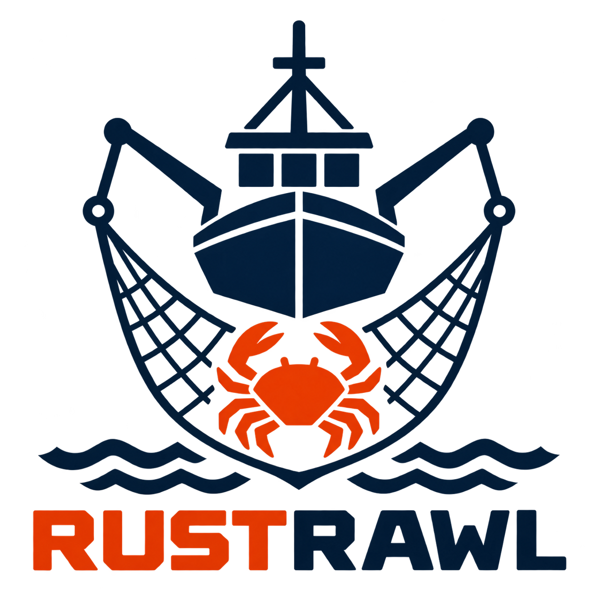

<p align="center">
  
</p>

# rustrawl

Internal network discovery and enumeration tool for pentest engagements.
One binary, one SQLite registry per perimeter: rate-controlled SYN sweep
with /24 expansion, operator-driven nmap fingerprinting, hostname
collection, headless-browser screenshot evidence, a CLI console and a
browser dashboard.

## Build

Any recent stable Rust toolchain. No libpcap: the SYN engine uses raw
sockets, so the binary builds static against musl.

```
cargo build --release
cargo build --release --target x86_64-unknown-linux-musl   # static
```

SYN mode needs root or CAP_NET_RAW. Without them, `--mode auto` falls
back to TCP connect.

## Scope file

The perimeter is described in a YAML file. Full example with comments in
`config/example-scope.yaml`. Minimal:

```yaml
name: acme
includes:
  - 10.0.0.0/16
excludes:
  - 10.0.0.1/32
sensitive_zones:
  - range: 10.0.50.0/24
    policy: passive          # zero probes; light = reduced profile
discovery:
  rate_pps: 10000
  ports: top25               # topN | full | explicit list, per-range profiles available
scan:
  nmap_args: "-sC -sV -p-"   # the port list rides here
```

Everything discovered stays inside `includes` minus `excludes`, always.

## Commands

```
rustrawl run  scope.yaml --out data/acme [--mode auto|syn|connect] [--resume] [--force] [--dry-run]
rustrawl scan scope.yaml --out data/acme [--nmap-args "..."] [--profile "range=args"] [--threads 4]
rustrawl names --out data/acme [--dns ip:port] [--zone domain] [--sources dns,tls,ldap]
rustrawl web  --out data/acme [--timeout 7] [--threads 4]
rustrawl db   --out data/acme              # interactive console
rustrawl db   --out data/acme stats        # counts + run outcomes
rustrawl db   --out data/acme export       # the registry as nmap XML on stdout
rustrawl db   --out data/acme --web        # the browser dashboard
```

`scan` is also available as `fp`.

### run (discovery)

Rate-controlled SYN sweep (token bucket, jitter, seeded permutation),
then /24 expansion of live neighborhoods, liveness only. Verdicts land in
`scandb.sqlite`: a miss is retried after a delay (7 days default), an up
verdict ages out (30 days default), done hosts are skipped (`skip_done`,
`--force` to ignore). `^C` is safe: state is saved and `--resume`
continues exactly where it stopped. `--dry-run` prints the plan without
sending a packet. Exit code 2 means the sweep suspected filtering.

### scan (nmap)

Queues every up host from the registry and runs nmap over it, 32 hosts
per process, `--threads` in parallel. The port list is yours: it rides in
the nmap args (`-p-`, `-p 21,22`, `--exclude-ports`). Per-range profiles
partition the queue, first match wins:

```
rustrawl scan scope.yaml --out data/acme --profile "10.0.40.0/24=-p 22,80,9100 -sV"
```

Crash-safe resume, interactive controls on a TTY (`p` pause, `k` kill and
requeue, `x` kill, `q` stop). Every open port lands in the registry.

### names (hostnames)

Collects hostnames for known assets without rescanning: verified DNS
PTR, one-attempt AXFR, TLS certificate CN/SAN, LDAP machine accounts. It
only touches endpoints the registry already lists. LDAP credentials come
from the environment: `RUSTRAWL_LDAP_BIND=user:password` (cleartext on
389, the run warns about it).

### web (screenshot evidence)

For every http/https service the registry classifies: one headless
chromium screenshot, HTTP response headers, page title, and a match
against a built-in signature table (appliance login pages, network gear,
IPMI, printers, NAS, and the generic 401/403/Index of / buckets).
Targets come from the registry, never probed into existence. Needs a
chromium-family browser (`RUSTRAWL_CHROME_BIN` or PATH) and `curl`
(`RUSTRAWL_CURL_BIN`). Without a browser the row still carries headers,
title and fingerprint. Identical screenshots are deduplicated by SHA-256.

## Read the results

The console:

```
rustrawl db --out data/acme
```

Four levels (`ranges`, `hosts`, `services`, `db`), search and filters,
one-host rescans, triage marks and notes, exports as CSV, TXT and
nmap-format XML.

The dashboard:

```
rustrawl db --out data/acme --web        # http://127.0.0.1:8391
```

/24 buckets, sortable and filterable tables, host sheets with the nmap
evidence per run, triage (todo / vuln / clean), pwned mark, tags, markdown
notes with pasted screenshots, a rescan tab with live nmap output, and a
capture tab over the screenshot runs. Writes are limited to triage, marks,
asset types, notes and rescans, and every write requires an
`X-Rustrawl: 1` header that a cross-origin page cannot set. Binds
127.0.0.1 unless `--bind` says otherwise.

## Data layout

```
data/acme/
├── scandb.sqlite              # the registry, queried before every scan decision
├── run.lock                   # one scan at a time per perimeter
└── runs/
    ├── discovery_<date>_<time>/   # ip.txt, live.jsonl, state.json, run.log
    ├── scan_<date>_<time>/        # scans/*.gnmap, .out, .argv, scan_state.json
    ├── names_<date>_<time>/       # names.log
    ├── manual_<date>_<time>/      # dashboard rescans
    └── web_<date>_<time>/         # targets.jsonl, shots/, cap_state.json
```

## Requirements

Linux. `nmap` for `scan`, a chromium-family browser and `curl` for `web`,
root or CAP_NET_RAW for SYN mode.

Rust dependencies: `libc`, `pnet_packet`, `rand_chacha`, `fs2`, `roaring`,
`rusqlite` (bundled), `serde`, `serde_json`, `clap`. No async runtime, no
libpcap, no frontend framework: the dashboard page is self-contained.

## Status

Done: discovery (SYN and connect engines, resume, kill switch, ICMP
liveness, sweep profiles, interface pinning), scan (chunking, profiles,
resume, interactive controls), names, web capture, db console, dashboard,
triage and asset classification, exports, CI (tests, clippy, fmt, musl
build).

Open: nmap `-O` as an opt-in scan profile, class-targeted scans.

## Safety

`sensitive_zones` arms `passive` (zero probes) or `light` policies per
range. All probes can be pinned to one interface. One scan at a time per
perimeter (`run.lock`). Use only on networks you are authorized to test.

## License

GPL-3.0: anyone may use, modify and redistribute the code, and any
redistributed version, modified or not, stays under the GPL with its
source. Full text in LICENSE.
